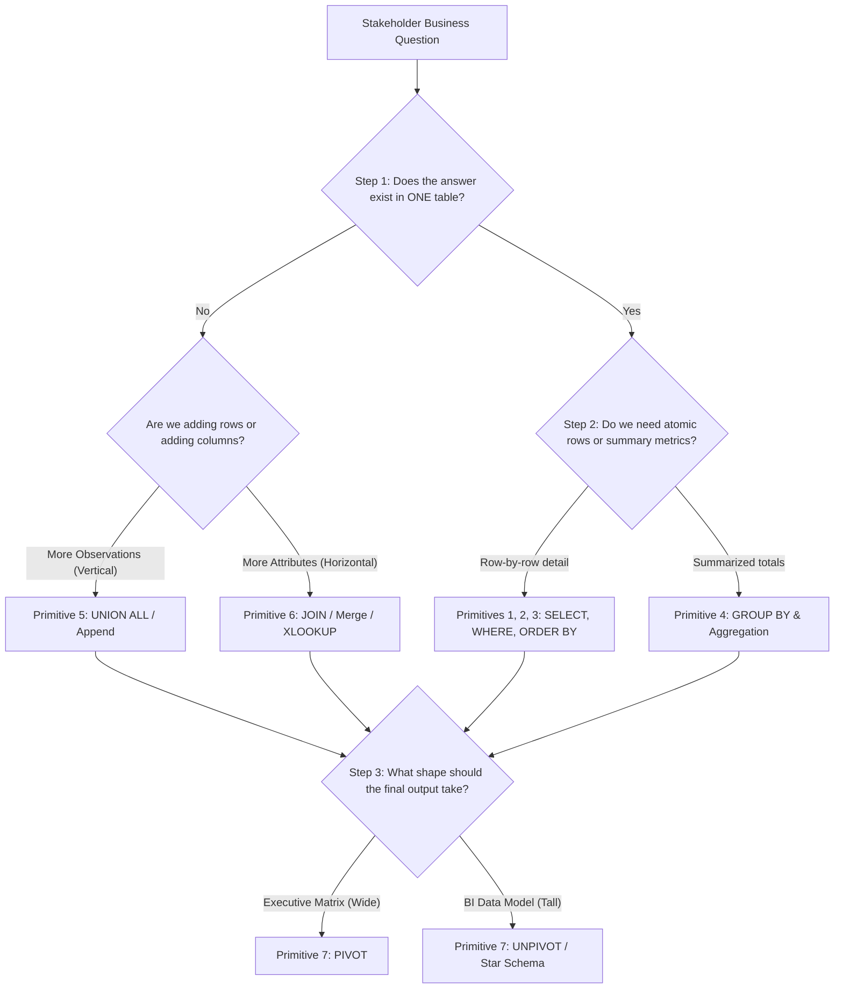

## 1. The Core Law of Tabular Data

Every data analyst begins their journey overwhelmed by an endless barrage of syntax:
* In **SQL**, you memorize `SELECT`, `WHERE`, `GROUP BY`, `HAVING`, `WINDOW`, `UNION`, `JOIN`.
* In **Python (Pandas)**, you memorize `.loc[]`, `.iloc[]`, `.groupby()`, `.merge()`, `.concat()`, `.pivot_table()`, `.melt()`.
* In **Microsoft Excel**, you memorize `FILTER()`, `CHOOSECOLS()`, `XLOOKUP()`, `VSTACK()`, `HSTACK()`, `SUMIFS()`, and Pivot Tables.
* In **Power BI & Power Query**, you memorize *Choose Columns*, *Group By*, *Append Queries*, *Merge Queries*, *Unpivot Columns*, and DAX measures.

Learners assume these are four completely distinct technologies that require years of separate study.

> **The Architectural Truth**:
> Almost all structured business data is **2D tabular data** composed strictly of **rows (observations)** and **columns (attributes)**. 
> Every data transformation—regardless of whether it runs on a spreadsheet, in a relational database, or inside a high-performance in-memory columnar engine—is a mathematical manipulation of those two dimensions.
> 
> **95% of all data analysis reduces to exactly 7 primitive operations.** If you understand what each primitive does to the underlying 2D matrix, you can switch between SQL, Pandas, Excel, and Power BI in 48 hours.

---

## 2. The 7 Primitives: Conceptual Blueprint & Visual Mapping

```
                               ┌────────────────────────────────────────────────────────┐
                               │           THE 7 TABULAR DATA PRIMITIVES                │
                               └───────────────────────────┬────────────────────────────┘
                                                           │
        ┌──────────────────────────────────────────────────┼──────────────────────────────────────────────────┐
        │                                                  │                                                  │
┌───────▼────────────────────────┐              ┌──────────▼────────────────────────┐             ┌───────────▼────────────────────────┐
│   SINGLE TABLE TRANSFORMATIONS │              │      MULTI-TABLE COMBINATIONS     │             │        DIMENSIONAL RESHAPING       │
├────────────────────────────────┤              ├───────────────────────────────────┤             ├────────────────────────────────────┤
│ 1. Add or Filter Columns       │              │ 5. Attach One Below Another       │             │ 7. Pivot / Unpivot (Melt)          │
│ 2. Add or Filter Rows          │              │    (Vertical Stack: UNION ALL)    │             │    (Wide Matrix vs Tall Normalized)│
│ 3. Order by Columns (Sort)     │              │ 6. Attach Side-by-Side            │             └────────────────────────────────────┘
│ 4. Group & Aggregate           │              │    (Horizontal Join on Keys)      │
└────────────────────────────────┘              └───────────────────────────────────┘
```

---

## 3. Deep-Dive: Syntax Comparison & Code Artifacts

### Primitive 1: Add or Filter Columns (Vertical Slicing & Feature Engineering)
* **What is happening**: You alter the horizontal width of your dataset by keeping specific columns, discarding irrelevant ones, or calculating new attributes row-by-row.
* **SQL**:
  ```sql
  SELECT order_id, customer_id, unit_price * quantity AS total_price
  FROM orders;
  ```
* **Python (Pandas)**:
  ```python
  df_subset = df[['order_id', 'customer_id']].copy()
  df_subset['total_price'] = df['unit_price'] * df['quantity']
  ```
* **Microsoft Excel**:
  ```excel
  =CHOOSECOLS(OrdersTable, 1, 2)
  =[@unit_price] * [@quantity]
  ```
* **Power BI / Power Query**:
  * Power Query: *Home > Choose Columns*
  * Power Query: *Add Column > Custom Column*: `[unit_price] * [quantity]`
  * DAX Calculated Column: `Total Price = Orders[unit_price] * Orders[quantity]`

---

### Primitive 2: Add or Filter Rows (Horizontal Slicing & Sampling)
* **What is happening**: You restrict the vertical length of your dataset based on conditional boolean logic, sample top rows, or eliminate duplicate entries.
* **SQL**:
  ```sql
  SELECT * FROM orders
  WHERE status = 'Completed' AND order_date >= '2026-01-01'
  LIMIT 50;
  ```
* **Python (Pandas)**:
  ```python
  filtered_df = df[(df['status'] == 'Completed') & (df['order_date'] >= '2026-01-01')].head(50)
  # Or using query syntax
  filtered_df = df.query("status == 'Completed' and order_date >= '2026-01-01'").head(50)
  ```
* **Microsoft Excel**:
  ```excel
  =FILTER(OrdersTable, (OrdersTable[status]="Completed") * (OrdersTable[order_date]>=DATE(2026,1,1)))
  ```
* **Power BI / Power Query**:
  * Power Query: *Filter Rows* dropdown menu; *Home > Keep Top Rows (50)*
  * DAX: `CALCULATETABLE(Orders, Orders[status] = "Completed")`

---

### Primitive 3: Order by Columns (Positional Sorting)
* **What is happening**: Reordering rows based on values in one or more columns (ascending or descending) to inspect extrema, prepare window ranks, or format reports.
* **SQL**:
  ```sql
  SELECT * FROM orders
  ORDER BY status ASC, order_date DESC;
  ```
* **Python (Pandas)**:
  ```python
  df_sorted = df.sort_values(by=['status', 'order_date'], ascending=[True, False])
  ```
* **Microsoft Excel**:
  ```excel
  =SORTBY(OrdersTable, OrdersTable[status], 1, OrdersTable[order_date], -1)
  ```
* **Power BI / Power Query**:
  * Power Query: Select column headers > *Sort Ascending* / *Sort Descending*
  * Power BI Model View: Select field > *Modeling > Sort by Column*

---

### Primitive 4: Group & Aggregate (Dimensional Collapse)
* **What is happening**: Collapsing multiple individual rows into summary buckets and calculating scalar metrics (sum, mean, count, min, max) per group.
* **SQL**:
  ```sql
  SELECT category, COUNT(*) AS total_orders, SUM(total_price) AS total_revenue
  FROM orders
  GROUP BY category;
  ```
* **Python (Pandas)**:
  ```python
  summary = df.groupby('category').agg(
      total_orders=('order_id', 'count'),
      total_revenue=('total_price', 'sum')
  ).reset_index()
  ```
* **Microsoft Excel**:
  * Insert *Pivot Table* > Drag `category` to Rows, drag `total_price` to Values (Sum).
  * Formula: `=SUMIFS(Orders[total_price], Orders[category], "Electronics")`
* **Power BI / Power Query**:
  * Power Query: *Transform > Group By*
  * DAX Measures:
    ```dax
    Total Revenue = SUM(Orders[total_price])
    Total Orders = COUNTROWS(Orders)
    ```

---

### Primitive 5: Attach Table One Below Another (Vertical Stacking / Append)
* **What is happening**: Combining two tables that share the same schema (columns) to increase observation count (rows). E.g., combining Q1 Sales and Q2 Sales.
* **SQL**:
  ```sql
  SELECT * FROM q1_sales
  UNION ALL
  SELECT * FROM q2_sales;
  ```
* **Python (Pandas)**:
  ```python
  df_combined = pd.concat([df_q1, df_q2], axis=0, ignore_index=True)
  ```
* **Microsoft Excel**:
  ```excel
  =VSTACK(Q1_Table, Q2_Table)
  ```
* **Power BI / Power Query**:
  * Power Query: *Home > Append Queries > Append Queries as New*

---

### Primitive 6: Attach Table Side by Side (Horizontal Combination / Merge / Join)
* **What is happening**: Enriching an existing table with new attributes from a second table by matching records on common keys (Primary Key to Foreign Key).
* **SQL**:
  ```sql
  SELECT o.order_id, o.order_date, c.customer_name, c.city
  FROM orders o
  LEFT JOIN customers c ON o.customer_id = c.customer_id;
  ```
* **Python (Pandas)**:
  ```python
  enriched_df = pd.merge(orders, customers, on='customer_id', how='left')
  ```
* **Microsoft Excel**:
  ```excel
  =XLOOKUP([@customer_id], Customers[customer_id], Customers[customer_name])
  =HSTACK(Table1, Table2)
  ```
* **Power BI / Power Query**:
  * Power Query: *Home > Merge Queries* (Select Join Kind: *Left Outer*)
  * Power BI Model View: Drag relationship line from `Customers[customer_id]` to `Orders[customer_id]` (1-to-many relationship).

---

### Primitive 7: Pivot and Unpivot (Dimensional Reshaping)
* **What is happening**: 
  * **Pivot (Tall to Wide)**: Turning unique row values into column headers for presentation matrices.
  * **Unpivot / Melt (Wide to Tall)**: Turning column headers into row values to normalize denormalized spreadsheets into machine-readable relational tables.
* **SQL**:
  ```sql
  -- Standard conditional aggregation (universal across all SQL engines)
  SELECT sales_rep,
         SUM(CASE WHEN quarter = 'Q1' THEN revenue ELSE 0 END) AS q1_revenue,
         SUM(CASE WHEN quarter = 'Q2' THEN revenue ELSE 0 END) AS q2_revenue
  FROM quarterly_sales
  GROUP BY sales_rep;
  ```
* **Python (Pandas)**:
  ```python
  # Pivot (Tall -> Wide)
  wide_df = df.pivot_table(index='sales_rep', columns='quarter', values='revenue', aggfunc='sum')

  # Unpivot / Melt (Wide -> Tall)
  tall_df = pd.melt(wide_df.reset_index(), id_vars=['sales_rep'], var_name='quarter', value_name='revenue')
  ```
* **Microsoft Excel**:
  * **Pivot**: Drag `Quarter` into the Columns shelf of a Pivot Table.
  * **Unpivot**: Load table into Power Query > Select identification columns > Right-click > *Unpivot Other Columns*.
* **Power BI / Power Query**:
  * Power Query: *Transform > Pivot Column* vs *Transform > Unpivot Columns*.

---

## 4. Production Truth & "Skipped Foundations"

> [!CAUTION]
> The biggest performance disasters in production analytics occur when analysts treat these 7 operations as pure abstract math without understanding memory engines and disk I/O.

### 1. `UNION` vs. `UNION ALL`: The Costly De-duplication Trap
* **Textbook**: Often introduces `UNION` first and presents `UNION ALL` as a footnote.
* **Production Reality**: `UNION` performs an implicit `DISTINCT` across every single column in both tables. To do this, database engines (Postgres, MySQL, Snowflake) must spill data to disk and run an expensive sort-and-hash deduplication pass. If you append two 10-million row tables with `UNION`, query time can jump from 2 seconds to 45 seconds. Always default to **`UNION ALL`** unless duplicate removal is an explicit business requirement.

### 2. Cartesian Product & Join Multipliers (Primitive 6)
* **Textbook**: Shows clean 1-to-1 relationships.
* **Production Reality**: If the right-hand lookup table contains non-unique join keys, a `LEFT JOIN` duplicates rows in your left table. An analyst calculating `SUM(total_revenue)` will silently report inflated, corrupt numbers to executives. Always audit key uniqueness (`COUNT(DISTINCT key) == COUNT(key)`) before joining.

### 3. Wide vs. Tall Data: Why Power BI Rejects Pivoted Spreadsheets
* **Textbook**: Praises wide matrix tables because humans prefer reading them on paper.
* **Production Reality**: High-performance analytical engines—such as Power BI’s VertiPaq, DuckDB, ClickHouse, and Pandas—are **columnar databases**. They compress repeating vertical column values at rates up to 10:1. When you feed wide, pivoted tables with 36 monthly columns into Power BI, compression collapses and DAX measures become extraordinarily difficult to write. Always **Unpivot** wide spreadsheets into Tall / Normalized schema before building dashboards.

---

## 5. The 3-Step Problem Solving Framework

Whenever a stakeholder asks a business question ("Which customer segment drove the highest churn after the Q3 price change?"), follow this diagnostic:



---

## 6. Official 1-Page PDF Reference Cheat Sheet

For quick offline reference, desk study, and interview preparation, we have compiled this entire 7-primitive framework, comparison table, and production rules into a branded 1-page PDF:

<div class="my-8 p-6 bg-blue-50/50 dark:bg-blue-950/20 border-2 border-blue-600/30 dark:border-blue-500/30 rounded-2xl flex flex-col sm:flex-row items-center justify-between gap-4">
  <div>
    <h4 class="text-lg font-bold text-slate-900 dark:text-white font-github">Download Official 1-Page Comparison Cheat Sheet</h4>
    <p class="text-sm text-slate-600 dark:text-slate-400 mt-1">High-resolution, printable PDF containing SQL, Pandas, Excel, and Power BI syntax for all 7 primitives.</p>
  </div>
  <a href="/cheatsheet/data-analysis-7-primitives/download" class="inline-flex items-center gap-2 px-5 py-2.5 bg-blue-600 hover:bg-blue-700 text-white font-medium text-sm rounded-xl shadow-sm transition-all whitespace-nowrap">
    <svg class="w-4 h-4" fill="none" stroke="currentColor" viewBox="0 0 24 24"><path stroke-linecap="round" stroke-linejoin="round" stroke-width="2" d="M12 10v6m0 0l-3-3m3 3l3-3m2 8H7a2 2 0 01-2-2V5a2 2 0 012-2h5.586a1 1 0 01.707.293l5.414 5.414a1 1 0 01.293.707V19a2 2 0 01-2 2z"/></svg>
    Download PDF Cheat Sheet
  </a>
</div>

---
*Authored by the Mythos Data Analytics Lead Faculty for **MYTHOS Online Institute** (`mythostech.in`).*
