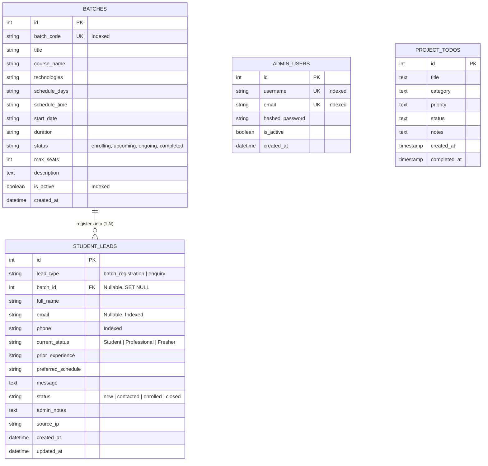

# Database Architecture & Schema Specification

## 1. Dual-Engine Database Architecture

The application implements a dual-engine architecture in [`app/apps/courses/database.py`](file:///f:/Projects/coding/app/apps/courses/database.py) designed for zero-configuration local development and resilient cloud deployment.

```
                      ┌────────────────────────────────────────┐
                      │          Database URL Check            │
                      └───────────────────┬────────────────────┘
                                          │
                     Is DATABASE_URL provided in environment?
                                          │
                    YES ──────────────────┴────────────────── NO
                     │                                         │
                     ▼                                         ▼
      ┌─────────────────────────────┐           ┌─────────────────────────────┐
      │   Cloud PostgreSQL Engine   │           │     Local SQLite Engine     │
      │  (Neon / Supabase / Render) │           │   (course_platform.db)      │
      ├─────────────────────────────┤           ├─────────────────────────────┤
      │ • Protocol rewrite:         │           │ • check_same_thread=False   │
      │   postgres:// -> postgresql://          │ • StaticPool fallback       │
      │ • pool_pre_ping=True        │           │ • Zero setup required       │
      │ • pool_recycle=300          │           │ • Excluded from git         │
      │ • pool_size=5               │           └─────────────────────────────┘
      │ • max_overflow=10           │
      └─────────────────────────────┘
```

### 1.1 Local Development (SQLite)
- **Database File**: `course_platform.db` (root directory).
- **Connection Configuration**:
  ```python
  engine = create_engine(
      "sqlite:///./course_platform.db",
      connect_args={"check_same_thread": False}
  )
  ```
- **Behavior**: Used automatically when `DATABASE_URL` is empty or unset. Allows developers and automated test harnesses to run without starting external database daemons.
- **Micro-App Database**: An independent SQLite database file (`portfolio.db`) is used exclusively for the `project_todos` micro-app.

### 1.2 Cloud Production (PostgreSQL)
- **Protocol Normalization**: Automatically converts legacy `postgres://` prefixes (commonly injected by older cloud platforms) to standard SQLAlchemy `postgresql://`.
- **Connection Pool Hardening**:
  - `pool_pre_ping=True`: Tests connection liveness with a lightweight `SELECT 1` before issuing queries, seamlessly discarding stale sockets closed by cloud firewalls.
  - `pool_recycle=300`: Actively recycles idle connections every 5 minutes to prevent network timeouts from managed databases (e.g. Neon serverless compute suspend).
  - `pool_size=5`: Keeps baseline connections conservative to stay well within free cloud database connection limits.
  - `max_overflow=10`: Allows controlled bursting for concurrent requests during marketing spikes.

---

## 2. Entity-Relationship Model



---

## 3. Complete Table Schemas

### 3.1 Table: `batches` (Mapped to `Batch`)
Stores scheduled live cohorts across faculties.

| Column | Type | Constraints | Default | Purpose |
| :--- | :--- | :--- | :--- | :--- |
| `id` | `Integer` | Primary Key, Autoincrement | Auto | Unique cohort identifier. |
| `batch_code` | `String(50)` | Unique, Indexed, Not Null | None | Human-readable batch code (e.g. `DA-WKND-2026-B1`). |
| `title` | `String(150)` | Not Null | None | Public batch title (e.g. `Weekend Data Analysis Masterclass`). |
| `course_name` | `String(150)` | Not Null | `Data Analysis` | Academic faculty or course offering name. |
| `technologies`| `String(255)` | Not Null | `Python, SQL, PowerBI...` | Comma-separated list of tools covered. |
| `schedule_days`| `String(100)`| Not Null | `Saturday & Sunday` | Batch days (Strictly weekend cohorts). |
| `schedule_time`| `String(100)`| Not Null | `6:00 PM – 8:00 PM IST` | Class timing slot. |
| `start_date` | `String(50)` | Not Null | `Upcoming Weekend` | Scheduled start date string. |
| `duration` | `String(50)` | Not Null | `8-10 Weeks Hands-On` | Overall course length. |
| `status` | `String(50)` | Not Null | `enrolling` | Cohort lifecycle (`enrolling`, `upcoming`, `ongoing`, `completed`). |
| `max_seats` | `Integer` | Not Null | `25` | Maximum cohort capacity. |
| `description` | `Text` | Nullable | `None` | Detailed syllabus or notes for batch. |
| `is_active` | `Boolean` | Indexed, Not Null | `True` | Flag controlling public visibility on registration forms. |
| `created_at` | `DateTime` | Not Null | `datetime.utcnow` | Creation timestamp. |

- **ORM Relationship**:
  - `registrations`: `relationship("StudentLead", back_populates="batch", cascade="all, delete-orphan")`

---

### 3.2 Table: `student_leads` (Mapped to `StudentLead`)
Captures all student admissions submissions and callback requests.

| Column | Type | Constraints | Default | Purpose |
| :--- | :--- | :--- | :--- | :--- |
| `id` | `Integer` | Primary Key, Autoincrement | Auto | Unique application record ID. |
| `lead_type` | `String(30)` | Indexed, Not Null | None | Type of lead (`batch_registration` or `enquiry`). |
| `batch_id` | `Integer` | Foreign Key (`batches.id`), Nullable, Indexed | `None` | Associated cohort (`ondelete="SET NULL"`). |
| `full_name` | `String(120)` | Not Null | None | Student full legal name. |
| `email` | `String(150)` | Nullable, Indexed | `None` | Student email address (**strictly optional**). |
| `phone` | `String(30)` | Indexed, Not Null | None | Student WhatsApp or mobile phone number (**mandatory**). |
| `current_status`| `String(80)`| Nullable | `None` | Background (`Working Professional`, `College Student`, `Fresher`). |
| `prior_experience`| `String(80)`| Nullable | `None` | Technical background (`Beginner`, `Basic Python`, `Excel User`). |
| `preferred_schedule`| `String(100)`| Nullable | `Saturday & Sunday...` | Preferred cohort timing. |
| `message` | `Text` | Nullable | `None` | Student questions, motivation, or target outcomes. |
| `status` | `String(30)` | Indexed, Not Null | `new` | Admissions funnel status (`new`, `contacted`, `enrolled`, `closed`). |
| `admin_notes`| `Text` | Nullable | `None` | Internal counseling notes recorded by admissions staff. |
| `source_ip` | `String(50)` | Nullable | `None` | Client IP address for rate-limiting and audit. |
| `created_at` | `DateTime` | Not Null | `datetime.utcnow` | Timestamp when application was submitted. |
| `updated_at` | `DateTime` | Not Null | `datetime.utcnow` | Timestamp when status/notes were last modified. |

- **Special Serializer Properties (`to_dict()`)**:
  - `created_date`: Calendar date formatted in IST (e.g. `Nov 18, 2026`).
  - `created_time`: 12-hour timestamp with AM/PM (e.g. `03:45 AM`).

---

### 3.3 Table: `admin_users` (Mapped to `AdminUser`)
Stores administrative and testing instructor accounts.

| Column | Type | Constraints | Default | Purpose |
| :--- | :--- | :--- | :--- | :--- |
| `id` | `Integer` | Primary Key, Autoincrement | Auto | Unique administrator ID. |
| `username` | `String(80)` | Unique, Indexed, Not Null | None | Login handle (e.g. `admin`, `agent_admin`). |
| `email` | `String(150)` | Unique, Indexed, Not Null | None | Administrator email address. |
| `hashed_password`| `String(255)`| Not Null | None | Modern 12-round bcrypt salted password hash. |
| `is_active` | `Boolean` | Not Null | `True` | Account operational status. |
| `created_at` | `DateTime` | Not Null | `datetime.utcnow` | Account provisioning timestamp. |

---

### 3.4 Table: `project_todos` (SQLite inside `portfolio.db`)
Isolated task repository powering `/apps/todos`.

| Column | Type | Constraints | Default | Purpose |
| :--- | :--- | :--- | :--- | :--- |
| `id` | `Integer` | Primary Key, Autoincrement | Auto | Task ID. |
| `title` | `Text` | Not Null | None | Task summary. |
| `category` | `Text` | Nullable | `General` | Task category. |
| `priority` | `Text` | Nullable | `Medium` | Priority level (`High`, `Medium`, `Low`). |
| `status` | `Text` | Nullable | `pending` | State (`pending`, `completed`). |
| `notes` | `Text` | Nullable | `None` | Additional implementation notes. |
| `created_at`| `Timestamp` | Not Null | `CURRENT_TIMESTAMP` | Task creation time. |
| `completed_at`| `Timestamp`| Nullable | `None` | Completion time. |

---

## 4. Seeding & Database Initialization Lifecycle

The initialization function [`init_courses_db()`](file:///f:/Projects/coding/app/apps/courses/services.py) is called during application startup:

1. **Table Provisioning**: Executes `Base.metadata.create_all(bind=engine)` ensuring all tables exist idempotently.
2. **Default Batch Seeding**: If the `batches` table is empty, seeds active cohorts:
   - `DA-WKND-2026-B1`: Weekend Data Analysis Masterclass
   - `DM-PERF-2026-B1`: Performance Marketing & Paid Advertising
   - `DM-GROWTH-2026-B1`: SEO, Content Strategy & Social Media Growth
3. **Admin User Seeding Safeguards**:
   - Creates the `admin` profile (`admin@mythostech.in`) if missing.
   - **Zero Overwrite Safeguard**: The existing password hash is **never overwritten** unless `ADMIN_PASSWORD` or `ADMIN_PASSWORD_HASH` is explicitly defined in environment variables.
   - Creates the `agent_admin` profile (`agent@mythostech.in`) with `AGENT_PASSWORD` for automated test suites.

---

## 5. Pagination & Query Architecture

The admin leads table relies on efficient SQL-level pagination via `get_leads_paginated()`:

```python
def get_leads_paginated(
    db: Session,
    lead_type: Optional[str] = None,
    batch_id: Optional[int] = None,
    status: Optional[str] = None,
    search: Optional[str] = None,
    page: int = 1,
    per_page: int = 10
) -> Dict[str, Any]:
    query = db.query(StudentLead)
    # Filter conditions applied dynamically...
    total = query.count()
    items = query.order_by(StudentLead.created_at.desc()).offset((page - 1) * per_page).limit(per_page).all()
    # Compute total_pages, start_item, end_item, has_prev, has_next
```

- **Safety Caps**: `per_page` defaults to 10 and is hard-capped at 100 to prevent denial-of-service memory exhaustion.
- **Sorting**: Enforces reverse-chronological order (`created_at.desc()`).
